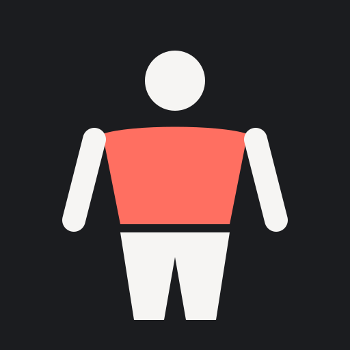

# Tempo

A personal workout tracker that runs as a web app, built around both the gym and football. Tap a muscle on the body map to log sets, track PBs, and watch the red recovery fill fade. It's self-hosted with Docker and only reachable from your own devices over Tailscale. Each person signs in with their own account and sees only their own data.

## Features

- **Quick log (+):** one tap to start a workout or a saved routine, or to log football, plyometrics or mobility. Sheets opened from another sheet have a back button.
- **Body map:** a shaded 2.5D front/back figure. Tap a muscle to log a workout; swipe or press the turn button to see the other side. Three views:
  - **Recovery:** trained muscles fill red and fade over their rest period.
  - **Volume:** weekly sets against a 10–20 target. A scrubber (or play button) replays the last 12 weeks one week at a time.
  - **Neglected:** muscles with no direct work in 10+ days pulse amber.
- **Muscle regions:** tapping a muscle shows an illustration of it cut into numbered regions (upper, mid and lower chest; front, side and rear delts; the quad and hamstring muscles…), each with its own shading. Exercises are grouped under the same numbers. Each group is a single collapsed row (name, exercise count and 8-week strength change) and one opens at a time, starting with the region you last trained, so the sheet stays short. Tapping a number on the illustration opens that region.
- **Logging and PBs:** every exercise shows its PB. Exercises are weighted (reps × kg), bodyweight (reps, optional added kg) or timed (with a stopwatch). The logger shows what you did last time and suggests your next target (double progression, going up sooner after a workout you rated easy, easing back in after a few weeks off, and a reset after three stalled sessions). It has a plate calculator, and ticking off a set or saving gives a haptic tap.
- **Plyometrics and mobility:** jumps, bounds and throws are logged as ground contacts and add leg fatigue by intensity; stretching and activation work (dead bugs, couch stretch, balance…) is logged without adding fatigue. Both are in the + menu and on each muscle.
- **Injuries:** from the Injuries page, log an injury by area and side; it's outlined on the body map and kept out of your daily plan until you mark it recovered. Each active injury has a return-to-play checklist (pain-free, range of motion, loaded strength, running, sprinting, full training); progression is paused for that muscle until loaded strength is cleared. History shows a 12-month timeline, days out and severity (FIFA consensus), and each injury shows the training load in the six weeks before it. Weekly prevention targets (Nordic curls, Copenhagen adductor, jumping and landing, balance) come from trials in footballers, are scheduled around match days, and are flagged as a priority where you've been injured before.
- **Workouts:** start a session to get a rest timer between sets and a finish summary (duration, volume, PBs, effort).
- **Routines:** save routines, start one as a guided workout, or quick-log the whole thing in one tap.
- **Football:** log matches and training (minutes × effort). Football loads your legs on the body map, and the daily plan works around your match and training days (set in Settings).
- **Daily plan:** learns your weekly routine and suggests exercises, skipping recovering or sore muscles. Use the soreness check-in (from the plan) when something aches.
- **Training load:** your acute:chronic workload ratio across gym and football, with a warning when load spikes.
- **Tracker:** a contribution graph, a calendar with day detail, and your weekly rhythm.
- **Progress:**
  - **Exercise history:** a chart of what you actually lifted, with a dot per session, your PBs highlighted, and a "best so far" staircase that steps up with each one. Bodyweight exercises chart reps (best set or total reps), or added weight once you add some; holds chart the longest hold. Estimated 1RM is a toggle away. There are 3M / 6M / 1Y / All ranges, best sets by rep count, and your change over the last 8 weeks.
  - **PBs:** every exercise with its personal best, a sparkline and its recent trend.
  - **Load, Bodyweight and Year in Review** tabs.
- **Evidence-based estimates:** effort per set is inferred as reps in reserve from your estimated 1RM (Wathen), fatigue decays exponentially per muscle, weekly volume counts hard sets, and training load uses session-RPE with an EWMA acute:chronic ratio. Settings → How the numbers work lists the sources.
- **Accounts:** sign in with email and password, or create an account; everyone's workouts, injuries, routines, settings and custom exercises are kept separate. Forgot your password? A reset link is emailed (it works once, for an hour) and signs you out everywhere else. Settings shows who's signed in and has Log out.
- **Works offline:** changes save on the device and sync when you're back online. Once you've signed in on a device, Tempo opens straight away even without a connection.
- **Backups:** daily database copies (to iCloud Drive if you like), plus a JSON export under Settings → Tools.

## Run locally (development)

Requires Node 24+.

```sh
npm install
npm run dev        # API on :3000, app on http://localhost:5173
```

The SQLite database is written to `./data/fitness.db`.

Run the tests (Node's built-in runner, no extra dependencies):

```sh
npm test
```

They cover the training maths (progression, trends, recovery, load, injuries, muscle regions), the server's validation and sync, accounts (separate data, sign-in, sessions, password resets, upgrading a single-user database), the reset email and backups.

In development, password reset links are printed in the API's terminal instead of emailed.

## Deploy with Docker + Tailscale

1. In the [Tailscale admin console](https://login.tailscale.com/admin/dns), enable **MagicDNS** and **HTTPS certificates**.
2. Create an auth key under **Settings → Keys**.
3. Copy `.env.example` to `.env` and paste in the key.
4. Run:

   ```sh
   docker compose up -d --build
   ```

5. Open `https://ember.<your-tailnet>.ts.net` on any device that has Tailscale installed. (The hostname is still `ember`, the app's original name, so existing home-screen installs keep working; change `hostname` and `TS_HOSTNAME` in `compose.yaml` to rename it.) On the host machine itself, `http://localhost:3000` also works.

**Install on iPhone:** open the URL in Safari, then **Share → Add to Home Screen**. It launches full-screen like a native app.

Data lives in the `app-data` Docker volume. To update after changing code, run `docker compose up -d --build`.

**Accounts:** the first account created takes over everything logged before accounts existed. Create it in the app (Create account), or from the host:

```sh
echo 'your password' | docker compose exec -T app node server/cli.ts create-user you@example.com
```

Anyone who can reach the URL can create an account; with Tailscale that's only devices on your tailnet. Passwords are hashed with scrypt; sessions last 90 days from last use.

**Password reset email:** set `APP_URL`, `SMTP_USER` (your Gmail address) and `SMTP_PASS` (a [Google app password](https://myaccount.google.com/apppasswords), which needs 2-Step Verification) in `.env`, then `docker compose up -d`. Until they're set, reset links are written to the log instead: `docker compose logs app | grep "Password reset"`. Any SMTP server that takes AUTH PLAIN over TLS on port 465 works too: set `SMTP_HOST` as well.

**Backups:** the server copies the database once a day (and on demand from Settings → Tools → Back up now), keeping the last 30. Copies go to `./backups`, or to `BACKUP_HOST_DIR` in `.env`. Point that at iCloud Drive (`~/Library/Mobile Documents/com~apple~CloudDocs/Tempo Backups`) to keep them off this machine. To restore one:

```sh
docker compose stop app
docker run --rm -v personal-fitness-tracker_app-data:/data -v "<backup folder>":/b alpine \
  sh -c 'rm -f /data/fitness.db-wal /data/fitness.db-shm && cp /b/fitness-YYYY-MM-DD.db /data/fitness.db && chown 1000:1000 /data/fitness.db'
docker compose start app
```

If Tailscale is already installed on the host, you can skip the sidecar. Run the `app` service with `ports: ["127.0.0.1:3000:3000"]` instead of `network_mode`, then run `tailscale serve --bg 3000`.
